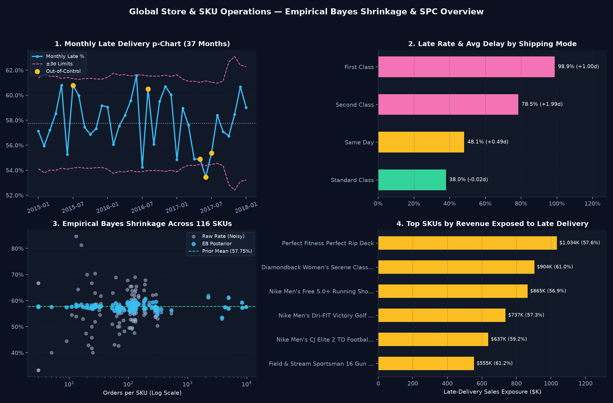
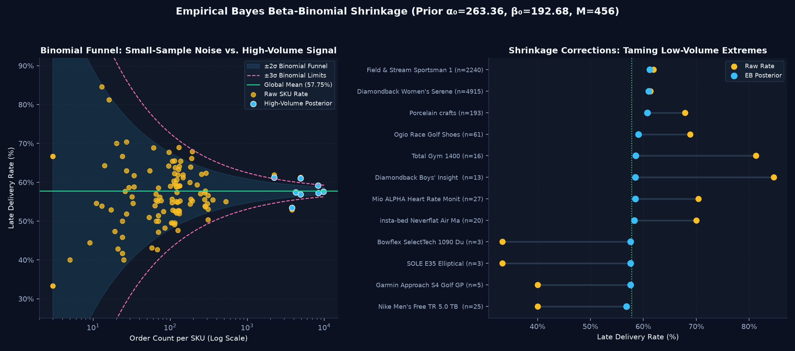
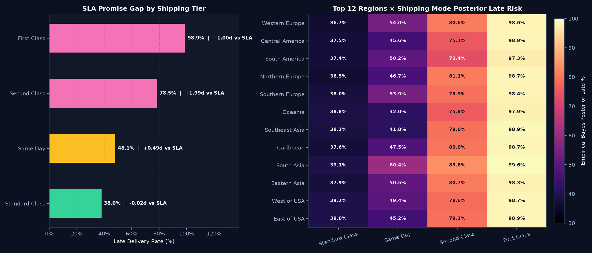
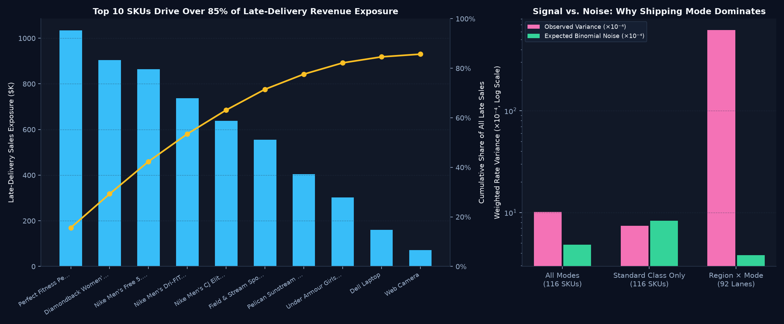
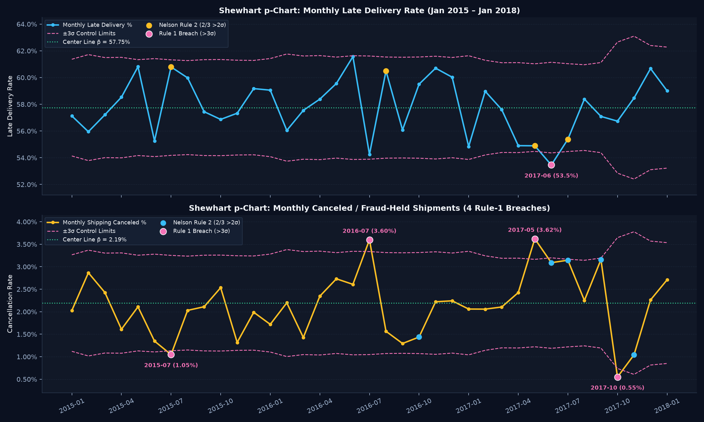
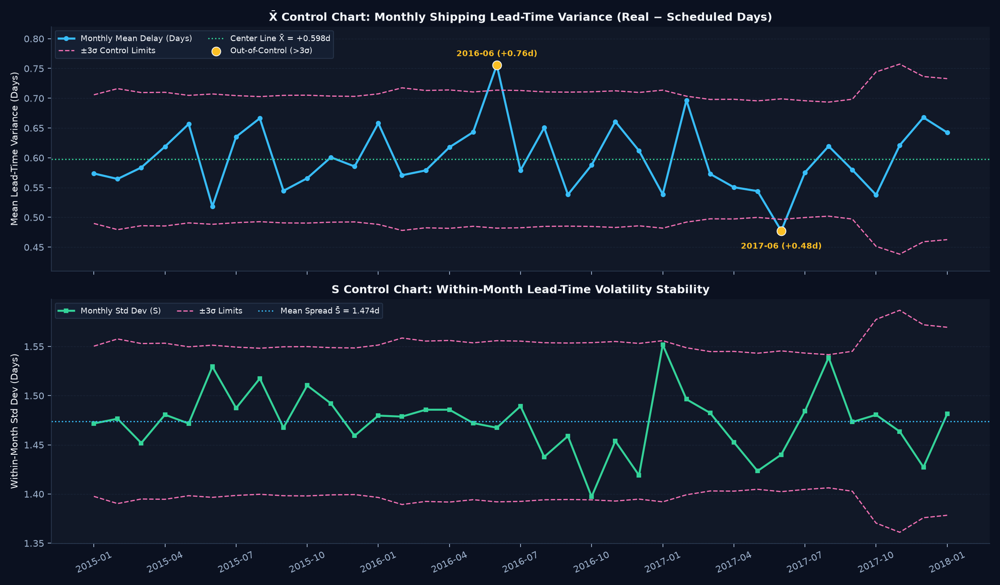

# Global Store & SKU Operations: Empirical Bayes & Statistical Process Control (`sku-operations-bayes-spc`)

> **Strategic Repository Name:** `sku-operations-bayes-spc`
> **GitHub Description:** `Shrinkage-adjusted SKU risk ranking (Empirical Bayes Beta-Binomial) and Shewhart Statistical Process Control (p-charts & X-bar/S charts) across 58,894 supply-chain order items, with Star Schema SQL and an AG Grid HTML5 workbench.`
> **Topics:** `empirical-bayes` · `statistical-process-control` · `supply-chain-analytics` · `sku-operations` · `python` · `star-schema` · `ag-grid` · `data-science-portfolio`

> **End-to-End Business Operations Case Study:** Direct audit and statistical modeling across **58,894 real-world order-item records** (**31,160 unique orders**, **116 SKUs**, **49 categories**, **23 global regions**, and **4 shipping modes** spanning **Jan 2015 – Jan 2018**). Replaces naive raw-rate ranking and ad-hoc clustering with **Empirical Bayes Beta-Binomial shrinkage** and **Shewhart Statistical Process Control ($p$-charts and $\bar{X}/S$ charts)**—exposing which issues are small-sample noise, which months broke statistical control, and why shipping-tier SLA promises drive almost all late-delivery variance.

<picture>
  <source media="(prefers-color-scheme: dark)" srcset="images/ops_overview_preview.png" />
  <source media="(prefers-color-scheme: light)" srcset="images/ops_overview_preview_light.png" />
  
</picture>

- **Interactive AG Grid HTML5 Workbench:** [`index.html`](index.html)
- **Kaggle Data Source:** [DataCo Smart Supply Chain for Big Data Analysis (`DataCoSupplyChainDataset.csv`)](https://www.kaggle.com/datasets/shashwatwork/dataco-smart-supply-chain-for-big-data-analysis)
- **Relational Star Schema & Analytical Views:** [`sql/sku_ops_star_schema.sql`](sql/sku_ops_star_schema.sql)
- **Empirical Bayes & SPC Python Pipeline:** [`src/sku_ops_analysis.py`](src/sku_ops_analysis.py)
- **Aggregated SKU, Lane & Monthly SPC JSON:** [`data/sku_ops_summary.json`](data/sku_ops_summary.json)

---

## Table of Contents
1. [Why Empirical Bayes & SPC Instead of K-Means](#1-why-empirical-bayes--spc-instead-of-k-means)
2. [Data Hygiene & Relational Star Schema](#2-data-hygiene--relational-star-schema)
3. [Empirical Bayes Shrinkage: Taming Small-Sample Noise](#3-empirical-bayes-shrinkage-taming-small-sample-noise)
4. [The Shipping Tier SLA Paradox](#4-the-shipping-tier-sla-paradox)
5. [Statistical Process Control: Separating Signals from Routine Noise](#5-statistical-process-control-separating-signals-from-routine-noise)
6. [Actionable Fulfillment & SLA Recommendations](#6-actionable-fulfillment--sla-recommendations)
7. [Repository Structure & Reproducible Verification](#7-repository-structure--reproducible-verification)

---

## 1. Why Empirical Bayes & SPC Instead of K-Means

Operations teams rarely need another unsupervised cluster label—they need clear, auditable answers to three everyday questions:
1. **Who is actually failing?** When one SKU has `3` orders (`66.7%` late) and another has `4,915` orders (`61.3%` late), raw percentages push the noisy low-volume item to the top of every triage list. **Empirical Bayes Beta-Binomial shrinkage** pulls low-volume extremes toward the global prior while keeping high-volume evidence intact.
2. **When did the process actually change?** A monthly late rate moving from `57%` to `60%` feels alarming until you test it against sample-size-adjusted $\pm 3\sigma$ control limits. **Shewhart $p$-charts and $\bar{X}/S$ charts** separate routine common-cause wobble from special-cause operational breaks.
3. **Where does the fix belong?** Comparing SKU variance overall against SKU variance inside a single shipping tier (`Standard Class`) tells leadership whether to fix **warehouse picking by product** or **customer-facing delivery promises by shipping tier**.

---

## 2. Data Hygiene & Relational Star Schema

Before fitting any model, [`src/sku_ops_analysis.py`](src/sku_ops_analysis.py) normalizes four real-world flaws discovered in `DataCoSupplyChainDataset.csv` (`58,894` rows, `44` columns, `$11,521,396` gross sales, `$1,261,692` profit):

| Field / Scope | Observed Raw Anomaly | Cleaning & Guardrail Rule |
| :--- | :--- | :--- |
| `order date (DateOrders)` | Mixed date formatting: `35,498` rows use `MM/DD/YYYY HH:MM` while `23,396` rows use `MM-DD-YYYY HH:MM`. | Parse with `format="mixed"` (`dayfirst=False`) so every order lands cleanly in its `YYYY-MM` period. |
| **Encoding & Strings** | `latin1` byte encoding plus trailing spaces (`'Health and Beauty '`). | Load with `encoding="latin1"` and strip whitespace across every categorical dimension. |
| **Canceled vs. Late Risk** | `1,291` canceled shipments (`672` `SUSPECTED_FRAUD` + `619` `CANCELED`) carry `Late_delivery_risk = 0`. | Monitor canceled shipments on a dedicated Shewhart $p$-chart so cancellations never look like on-time wins. |
| **Lead-Time Variance** | Scheduled windows (`0`, `1`, `2`, `4` days) mask actual carrier transit days. | Track `delay_days = Days_real - Days_scheduled` continuously across every tier and month. |

[`sql/sku_ops_star_schema.sql`](sql/sku_ops_star_schema.sql) models the clean dataset into 3 Dimension tables (`dim_sku`, `dim_geography`, `dim_customer`), 1 Fact table (`fact_order_items`), and 2 analytical SQL views (`vw_sku_empirical_bayes_inputs`, `vw_monthly_spc_control_inputs`).

---

## 3. Empirical Bayes Shrinkage: Taming Small-Sample Noise

<picture>
  <source media="(prefers-color-scheme: dark)" srcset="images/empirical_bayes_shrinkage.png" />
  <source media="(prefers-color-scheme: light)" srcset="images/empirical_bayes_shrinkage_light.png" />
  
</picture>

Using volume-weighted Method of Moments across all **116 SKUs**, the network fits a global baseline prior of **`Beta(α₀ = 263.36, β₀ = 192.68)`**—an effective prior strength of **`M = 456` orders** centered at **`57.75%`** late delivery. Every SKU's posterior estimate blends its observed record with that baseline:

$$\hat{p}_{\text{EB}, i} = \frac{k_i + \alpha_0}{n_i + \alpha_0 + \beta_0}$$

| Comparison Group | Product (SKU) | Orders ($n$) | Raw Late % | EB Posterior % | Shrinkage Shift | Late Sales Exposure |
| :--- | :--- | ---: | ---: | ---: | ---: | ---: |
| **Raw Spike Tamed** | *Diamondback Boys' Insight 24 Performance Hybrid* | 13 | 84.62% | **58.49%** | `-26.12 pp` | `$3,189` |
| **Raw Spike Tamed** | *Total Gym 1400* | 16 | 81.25% | **58.55%** | `-22.70 pp` | `$3,900` |
| **False Safe Tamed** | *Bowflex SelectTech 1090 Dumbbells* | 3 | 33.33% | **57.59%** | `+24.26 pp` | `$600` |
| **True High-Risk Leader** | *Field & Stream Sportsman 16 Gun Fire Safe* | 2,240 | 61.92% | **61.21%** | `-0.71 pp` | **`$554,772`** |
| **True High-Risk Leader** | *Diamondback Women's Serene Classic Comfort Bike* | 4,915 | 61.30% | **61.00%** | `-0.30 pp` | **`$903,840`** |

**Revenue Concentration:** Just **10 high-volume SKUs** account for **85.68% (`$5,669,663`)** of all `$6,617,043` in sales exposed to late delivery.

---

## 4. The Shipping Tier SLA Paradox

<picture>
  <source media="(prefers-color-scheme: dark)" srcset="images/lane_risk_heatmap_shipping_mode.png" />
  <source media="(prefers-color-scheme: light)" srcset="images/lane_risk_heatmap_shipping_mode_light.png" />
  
</picture>

When we apply the exact same Empirical Bayes variance decomposition **inside `Standard Class` alone**, between-SKU variance drops from `0.000741` observed to **zero excess variance** below expected binomial noise (`0.000832`). Meanwhile, **Region × Shipping Mode** lanes carry **`0.06188` true between-lane variance**—over **115× larger** than SKU-level variance (`0.000534`).

| Shipping Mode | Order Items | Share | Late Rate | Scheduled Days | Actual Days | Mean Variance | Total Sales |
| :--- | ---: | ---: | ---: | ---: | ---: | ---: | ---: |
| **First Class** | 10,627 | 18.0% | **98.88%** | 1.00 d | 2.00 d | `+1.00 d` | `$2,074,747` |
| **Second Class** | 11,859 | 20.1% | **78.49%** | 2.00 d | 3.99 d | **`+1.99 d`** | `$2,290,162` |
| **Same Day** | 3,576 | 6.1% | **48.13%** | 0.00 d | 0.49 d | `+0.49 d` | `$668,909` |
| **Standard Class** | 32,832 | 55.8% | **37.99%** | 4.00 d | 3.98 d | **`-0.02 d`** | `$6,487,578` |

<picture>
  <source media="(prefers-color-scheme: dark)" srcset="images/sku_financial_exposure_pareto.png" />
  <source media="(prefers-color-scheme: light)" srcset="images/sku_financial_exposure_pareto_light.png" />
  
</picture>

**Key Finding:** `First Class` promises 1-day shipping on a 2-day network (`98.88%` late), and `Second Class` promises 2 days on a 4-day network (`78.49%` late). **Customers are not waiting longer because of individual SKUs—they are seeing broken promises caused by unrealistic SLA labels.**

---

## 5. Statistical Process Control: Separating Signals from Routine Noise

<picture>
  <source media="(prefers-color-scheme: dark)" srcset="images/spc_p_chart_late_delivery.png" />
  <source media="(prefers-color-scheme: light)" srcset="images/spc_p_chart_late_delivery_light.png" />
  
</picture>

Across **37 monthly periods (`2015-01` to `2018-01`)**, Shewhart control charts distinguish normal month-to-month fluctuation from genuine process shifts:

1. **Late Delivery $p$-Chart ($\bar{p} = 57.75\%$):**
   - **Rule 1 (`>3σ`) Breach — `2017-06` (`53.46%`):** Dropped cleanly below the Lower Control Limit, coinciding with `Standard Class` rising to `59.6%` of monthly volume (vs. `55.75%` overall).
   - **Nelson Rule 2 (`2/3 >2σ`) Warnings:** Elevated runs in `2015-07` (`60.79%`) and `2016-08` (`60.50%`), and favorable dips in `2017-05` (`54.89%`) and `2017-07` (`55.38%`).
2. **Cancellation / Fraud Risk $p$-Chart ($\bar{p}_c = 2.19\%$):**
   - **Four Rule-1 (`>3σ`) Breaches:** High spikes in **`2016-07` (`3.60%`)** and **`2017-05` (`3.62%`)**, and unusually quiet months in **`2015-07` (`1.05%`)** and **`2017-10` (`0.55%`)**.
3. **Lead-Time Variance $\bar{X}$ & $S$ Charts ($\bar{X} = +0.598\text{d}$, $\bar{S} = 1.474\text{d}$):**
   - **Two Rule-1 (`>3σ`) Breaches:** **`2016-06` (`+0.756` days)** pushed above UCL as `Standard Class` share dipped to `52.0%`, while **`2017-06` (`+0.477` days)** broke below LCL. Meanwhile, the **$S$ chart stayed inside $\pm 3\sigma$ for all 37 months**, showing consistent day-to-day spread.

<picture>
  <source media="(prefers-color-scheme: dark)" srcset="images/spc_xbar_lead_time_drift.png" />
  <source media="(prefers-color-scheme: light)" srcset="images/spc_xbar_lead_time_drift_light.png" />
  
</picture>

---

## 6. Actionable Fulfillment & SLA Recommendations

1. **Recalibrate `First Class` and `Second Class` Checkout Promises (22,486 Orders / `$4.36M` Sales):**
   - *Finding:* `First Class` (`2.00` actual days vs. `1.00` promised) and `Second Class` (`3.99` actual days vs. `2.00` promised) fail `98.88%` and `78.49%` of the time across every global region.
   - *Action:* Re-label `First Class` as **2-Day Express** and align `Second Class` with **4-Day Standard** unless dedicated air-freight carriers are contracted—immediately eliminating structural SLA misses without changing warehouse spend.
2. **Focus Bulky-SKU Carrier Buffers on the Top 10 Exposure Items (`$5.67M` at Risk):**
   - *Finding:* Just `10` high-volume SKUs account for `85.68%` of late-delivery revenue, led by *Perfect Fitness Perfect Rip Deck* (`$1.03M`), *Diamondback Women's Serene Bike* (`$904K`), and *Field & Stream 16 Gun Fire Safe* (`$555K`).
   - *Action:* Ignore 3–20 order noisy outliers surfaced by raw percentages; stage regional inventory buffers and freight-specific SLAs around those top `10` SKUs.
3. **Automate Monthly SPC Triage on Cancellation Spikes (`>3σ` Rule-1 Alerts):**
   - *Finding:* Cancellations and suspected fraud spiked above `3σ` in `2016-07` (`3.60%`) and `2017-05` (`3.62%`), creating silent revenue leakage masked by `Late_delivery_risk = 0`.
   - *Action:* Pair the `p`-chart for `Shipping canceled` with automated fraud-queue audits whenever any month crosses `+2σ` (`~3.0%`) or triggers a 2-of-3 Nelson Rule-2 warning.

---

## 7. Repository Structure & Reproducible Verification

```text
sku-operations-bayes-spc/
├── images/
│   ├── ops_overview_preview.png            # 4-panel executive summary hero banner
│   ├── empirical_bayes_shrinkage.png       # Binomial funnel & raw-to-posterior dumbbell chart
│   ├── spc_p_chart_late_delivery.png       # 37-month p-charts (late delivery & cancellations)
│   ├── spc_xbar_lead_time_drift.png        # 37-month X-bar & S charts on lead-time variance
│   ├── lane_risk_heatmap_shipping_mode.png # 12 top regions x 4 shipping tiers posterior heatmap
│   └── sku_financial_exposure_pareto.png   # Top 10 SKUs revenue Pareto & variance decomposition
├── data/
│   └── sku_ops_summary.json                # Aggregated metrics across 116 SKUs, 92 lanes & 37 months
├── sql/
│   └── sku_ops_star_schema.sql             # Relational Star Schema DDL & analytical views
├── src/
│   └── sku_ops_analysis.py                 # Clean Empirical Bayes & SPC pipeline + chart generator
├── index.html                              # Self-contained AG Grid Community HTML5 Workbench
├── verify.mjs                              # Automated data reconciliation & Impeccable checks
├── PRODUCT.md                              # Product context & Operate surface specification
├── DESIGN.md                               # Operate-mode design tokens & typography contract
├── .gitignore                              # Excludes raw 22.85 MB DataCo CSV
└── README.md                               # Complete English case study & methodology reference
```

### Run the Pipeline, Verification & Publish to GitHub

```powershell
# 1. Re-run Empirical Bayes & SPC analysis and regenerate all 6 charts (~8s)
uv run --with numpy --with pandas --with matplotlib python src/sku_ops_analysis.py

# 2. Run automated data reconciliation, Bayesian contract & HTML5 verification
node verify.mjs

# 3. Publish as a standalone GitHub repository (excludes the raw CSV via .gitignore)
git init
git add .
git commit -m "Add Global Store & SKU Operations Empirical Bayes and SPC workbench"
gh repo create sku-operations-bayes-spc --public --description "Empirical Bayes Beta-Binomial shrinkage & Shewhart Statistical Process Control across 58,894 supply-chain order items, with Star Schema SQL and AG Grid workbench." --source=. --remote=origin --push
```
